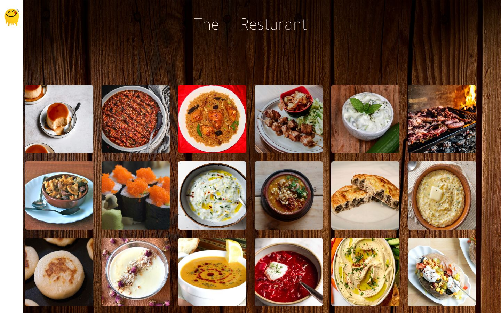
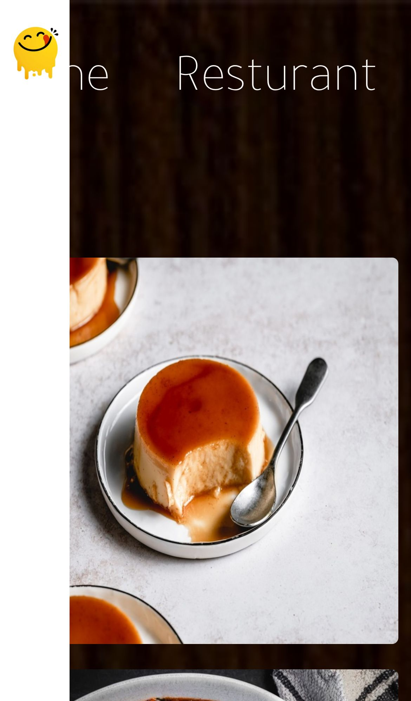
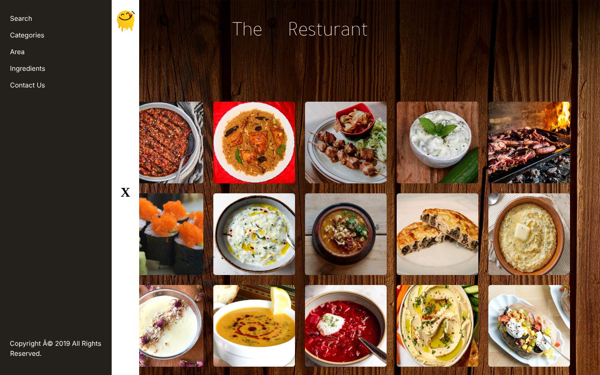
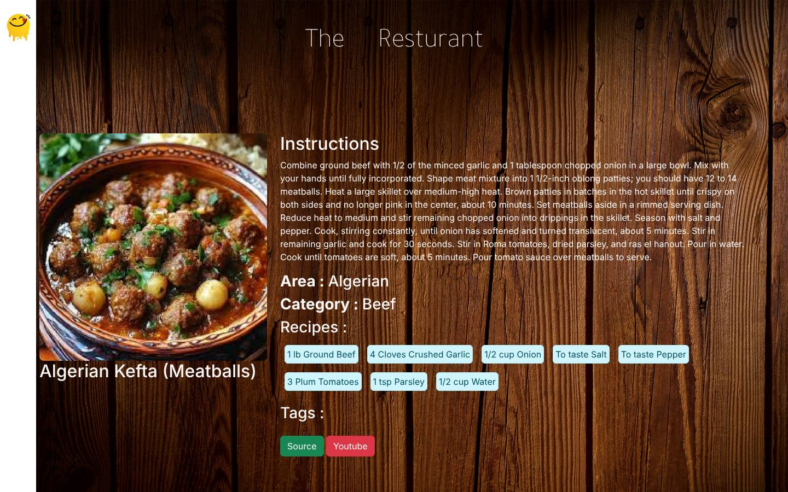

<div align="center">

# The Restaurant

### Recipe browser powered by TheMealDB API · HTML · CSS · JavaScript · jQuery

A single-page recipe explorer: browse meals by category, cuisine (area) or ingredient, search by name or first letter, and open any meal for its full recipe. Built for practice during my front-end training (December 2022).

[](https://developer.mozilla.org/docs/Web/HTML)
[](https://developer.mozilla.org/docs/Web/CSS)
[](https://developer.mozilla.org/docs/Web/JavaScript)
[](https://jquery.com)
[](https://getbootstrap.com)
[](https://fontawesome.com)
<br>
[](https://eslamraafat1.github.io/The-Resturant/)

**[Live demo](https://eslamraafat1.github.io/The-Resturant/)** ·
**[Portfolio](https://new-portfolio-ashy-xi.vercel.app/)** ·
**[LinkedIn](https://www.linkedin.com/in/eslamraafat-dev/)** ·
**[Email](mailto:eslamraafat736@gmail.com)**

<br>



</div>

<table>
  <tr>
    <td width="33%"></td>
    <td width="67%">
      <br><br>
      
    </td>
  </tr>
  <tr>
    <td align="center"><sub>Mobile (iPhone 13)</sub></td>
    <td align="center"><sub>Side navigation · Meal details view</sub></td>
  </tr>
</table>

---

## Overview

**The Restaurant** is a practice project from my 2022–2023 front-end training. It is not a website for a real restaurant: it is a client-side app that consumes the free public [TheMealDB](https://www.themealdb.com/api.php) API and renders everything dynamically into one page.

What I practised:

- Calling a REST API with `fetch` and `async`/`await`, and rendering the JSON responses as HTML template literals.
- Building a whole "multi-view" app inside a single `index.html` by swapping the content of one container.
- jQuery animations (`animate`, `fadeIn`/`fadeOut`) for the side menu and loading screens.
- Form validation with regular expressions.

## Features

### Browse and search

- **Home:** on load, the app requests every meal returned by an empty name search and shows them as a responsive card grid. Hovering a card slides up an overlay with the meal name.
- **Categories:** category cards with thumbnail and a 20-word description; clicking one lists its meals.
- **Area:** list of cuisines (e.g. Algerian, Italian…); clicking one lists its meals.
- **Ingredients:** the first 20 ingredients with a short description; clicking one lists meals that use it.
- **Search:** two live inputs, search by name or by first letter (one character, `maxlength="1"`), triggered on every keystroke.

### Meal details

- Image, name, full instructions, area and category.
- Ingredient list built from the API's `strIngredient1…20` / `strMeasure1…20` fields, shown as badges.
- Tags (when present) and buttons to the original **Source** and the **YouTube** video.

### Interface

- Animated off-canvas side navigation (jQuery `animate`), with menu items that slide in one after another.
- Full-screen loading screen on first load and an inner loading overlay for each request.

### Contact form

- Name, email, phone, age, password and confirm-password fields, validated on every keystroke with regular expressions.
- Error messages appear only after a field has been focused, and the **Submit** button stays disabled until every field is valid.
- Front-end only: the form is not connected to any back end.

## Tech stack

| Layer | Tools |
| --- | --- |
| Markup and styles | HTML5, CSS3 (`index.css`), Bootstrap 5.2.0 |
| Scripting | Vanilla JavaScript (`fetch`, `async`/`await`, template literals), jQuery 3.6.0 |
| Icons | Font Awesome Free 6.2.1 (bundled locally with its webfonts) |
| Fonts | Google Fonts |
| Data | [TheMealDB](https://www.themealdb.com/) public API (free test key `1`) |
| Hosting | GitHub Pages |

## Project structure

```text
.
├── index.html                 # single page: side nav, search container, results grid
├── index.js                   # API calls, rendering, side-nav animation, form validation
├── index.css                  # custom styles (background, overlays, loaders)
├── pexels-pixabay-326333.jpg  # wooden background image
├── Capture.PNG                # logo shown in the side navigation
├── bootstrap.min.css · bootstrap.bundle.min.js
├── jquery-3.6.0.min.js
├── all.min.css · all.min.js   # Font Awesome
├── webfonts/                  # Font Awesome font files
└── docs/screenshots/          # README images
```

## Getting started

No build step and no dependencies to install. The app needs an internet connection to reach TheMealDB.

```bash
git clone https://github.com/Eslamraafat1/The-Resturant.git
cd The-Resturant
npx serve .        # or simply open index.html in a browser
```

## Deployment

The site is deployed with **GitHub Pages** from the `master` branch: [eslamraafat1.github.io/The-Resturant](https://eslamraafat1.github.io/The-Resturant/).

## Author

**Eslam Raafat** — Front-End Developer (React · Next.js · TypeScript)

- **Portfolio:** [new-portfolio-ashy-xi.vercel.app](https://new-portfolio-ashy-xi.vercel.app/)
- **LinkedIn:** [linkedin.com/in/eslamraafat-dev](https://www.linkedin.com/in/eslamraafat-dev/)
- **GitHub:** [@Eslamraafat1](https://github.com/Eslamraafat1)
- **Email:** [eslamraafat736@gmail.com](mailto:eslamraafat736@gmail.com)

<sub>Meal data and images come from TheMealDB. This project is not affiliated with TheMealDB.</sub>
